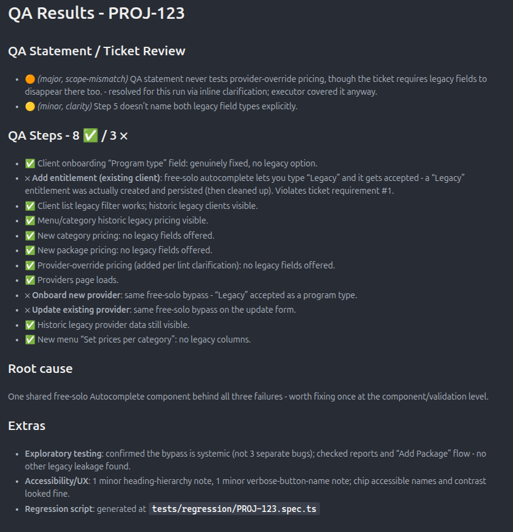

# qa-bot

A Claude Code plugin. Given a ticket, it takes the ticket's description and QA statement, lints the QA statement for clarity/consistency/missing context, executes it against a deployed system, and produces a results summary ready to paste into the ticket - or, for Jira, posts it as a comment if you choose.

For example:



- **Issue tracker:** Jira via an Atlassian MCP connection by default. Tickets from any other tracker (GitHub Issues, Linear, Azure DevOps, …) - or Jira without an MCP connection - work by pasting the summary, description and QA statement when asked.
- **What gets tested:** browser UI via the bundled Playwright MCP server, HTTP APIs via `curl`, or both in one QA statement.

The plugin is Markdown and config only - no scripts, no `npm install`. Runtime requirements: Node 18+ on `PATH` for browser testing (the Playwright MCP server runs via `npx`), and `curl` for API testing.

## Install

```
/plugin marketplace add https://github.com/agiledigital-labs/auto-qa
/plugin install qa-bot@qa-bot
```

To try a local checkout without installing: `claude --plugin-dir plugins/qa-bot`.

## Per-project setup

In the project you'll run QA from:

1. **Create `.env`** in the project root (see [.env.example](.env.example)) and make sure it's gitignored. It must exist, even if empty - the bundled Playwright MCP server loads it at startup and won't start without it, and API requests load it into a shell. Put only secrets in it (passwords, tokens, API keys), single-quoting any value containing spaces, `$` or quotes. After editing it, reconnect the Playwright server via `/mcp`.
2. **For Jira, connect an Atlassian MCP server (recommended)** - the claude.ai Atlassian connector, or `claude mcp add --transport http atlassian https://mcp.atlassian.com/v2/mcp` - and authenticate via `/mcp`. Alternatively, the ticket can be copied manually into the tool.
   1. The only required permission is `read_jira`, however `read_confluence` may be useful to provide additional context. `search_jira` and `search_confluence` may also be useful depending on your workflow.
   2. If you want to allow the plugin to add the results as a comment directly, you will need `write_jira`.

Your Claude session may need to be reloaded after connecting MCP servers for the changes to take effect.

## Usage

```
/qa-bot:qa-run PROJ-123
```

Any ticket reference works (`#412`, `ENG-77`, …). If it isn't shaped like `PROJ-123`, you're asked which project it belongs to.

For Jira tickets, it also checks the ticket's hygiene alongside the lint (both can be turned off - see below). The ticket must be in one of the project's QA-ready statuses, which you're asked once and which are recorded as `QA-ready statuses` under `## Issue Tracker` in `context/PROJ.md` (record `not checked` to skip the check). Until they're recorded, non-interactive runs only reject statuses in Jira's To Do category. The check also looks for unfinished sub-tasks and unresolved `is blocked by` links. A ticket that isn't QA-ready stops the run, unless you choose to proceed anyway.

This is interactive by design. On the first run for a project it asks where the system is deployed (app and/or API URL) and how to authenticate, and saves the answers to `context/PROJ.md`. It also records which issue tracker the project uses. For Jira via MCP, it works out which field (or description heading) holds the QA statement, confirms that with you, and records it. Later, if a QA statement is missing context the tool can't infer (login, API auth, test data), it asks and saves that too, so future tickets in the same project don't need to ask again. Only project-level facts are saved, summarised at a high level; details specific to one ticket (a particular record, a fixture only that ticket needs) are used for that run only.

Commit `context/PROJ.md` so the whole team shares the same context. It holds:
- **Literal values** for anything that isn't secret - app and API URLs, usernames, test data notes.
- **Secret names only** - backtick-quoted env var names such as `` `PROJ_STAGING_QA_PASSWORD` ``, whose values each person adds to their own `.env`.

A second file, `context/PROJ.app-notes.md`, builds up automatically alongside it - a high-level knowledge base of *how to drive this system* (UI navigation paths, form quirks, reliable selectors, API auth flows and conventions) that `qa-executor` writes and revises itself after every run, with no prompting needed. It's advisory: if the system has moved on since the notes were written, that's expected and not treated as a bug - the executor just adapts and corrects the file. Commit it too so the whole team benefits from what past runs learned.

Output lands in `runs/<TICKET>-<timestamp>/summary.md` (gitignore `runs/`), with failure screenshots in `screenshots/` and API responses in `responses/` alongside it. Saved responses can contain tokens or personal data returned by the API, so keep `runs/` local. For Jira tickets with a connected Atlassian MCP server, the run then offers to post the summary as a comment on the ticket (`--post-comment` answers yes in advance). Otherwise, copy the summary into the ticket yourself. A posted comment refers to screenshots and saved responses by their local path - they're never uploaded, since they can contain tokens or personal data. Nothing else on the ticket is changed.

Early on it asks which pre-execution checks to run. Both are on by default, and `--no-lint` / `--no-hygiene` turn them off in advance:
- **QA statement lint** - reviews the QA statement for clarity, scope against the description, missing context and steps that reach outside the system under test. Without it, nothing catches those before execution.
- **Ticket hygiene** (Jira tickets only) - the readiness checks described above.

A skipped check is noted in `summary.md`, so a missing review isn't mistaken for a clean one.

It also asks about optional extras, which are off by default (any combination, or none):
- **A regression script** - a reusable script covering this run's automated steps. Unlike everything under `runs/`, this is meant to be git-tracked - review it before committing. Secrets are read from `.env` by name at run time (`process.loadEnvFile`, Node ≥ 20.12), never written into the script.
  - QA statements with browser UI steps get a `@playwright/test` spec (UI via `page`, API via `request`) at `tests/regression/<TICKET>.spec.ts`. Running it needs `@playwright/test` in the project: `npx playwright test tests/regression/<TICKET>.spec.ts`.
  - API-only QA statements get a dependency-free Node script (`node:test` + `fetch`) at `tests/regression/<TICKET>.test.mjs`: `node --test tests/regression/<TICKET>.test.mjs`. Playwright's default `testMatch` also matches `*.test.mjs`, so run Playwright specs by path (or narrow `testMatch`) if both kinds share the directory.
- **Additional exploratory testing** - a bounded pass of extra checks around the feature (edge cases, error states, adjacent UI; for APIs, missing/invalid auth and malformed requests) beyond what the QA statement explicitly asks for, reported in its own section of `summary.md`.
- **Accessibility/UX testing** (browser UI only) - a bounded, heuristic pass (accessible names/labels, heading structure, keyboard/focus handling, ARIA correctness, obvious UX friction) over the pages/flows the QA statement touched, also reported in its own section of `summary.md`. Not a substitute for a real accessibility audit.

### Re-test

After a developer addresses issues from a run (and perhaps amends the QA statement), run `qa-run` for the ticket again. If earlier runs exist, it asks whether this is a re-test of the most recent one; `--retest` (latest previous run) or `--retest <run-dir>` answers in advance. A re-test fetches the ticket again and runs the **complete** current QA statement from scratch - steps that passed before are executed again, and the executor isn't told what failed previously. Afterwards the summary gains a "Changes Since Previous Run" section listing steps that were fixed, still fail, regressed, are new or amended, or were removed.

### Lint only

```
/qa-bot:qa-lint PROJ-123
```

Fetches the ticket the same way and runs only the linter - nothing is executed against the system. Useful for checking a QA statement before a ticket reaches QA. It runs the same ticket hygiene checks as `qa-run`. A ticket that isn't in a QA-ready status is reported as not ready to execute. The report lands in `runs/<TICKET>-<timestamp>/lint.md`, ready to paste into the ticket (or posted as a Jira comment, as for `qa-run`), with a verdict on whether the QA statement is ready to execute. It shares `context/PROJ.md` with `qa-run`, so the first-run setup questions apply here too.

### Non-interactive (CI/CD)

Add `--non-interactive` to either command to run unattended. Nothing is asked: each point that would ask either uses a flag or a safe default, or stops the run with a message saying what's missing.

```bash
PLAYWRIGHT_MCP_HEADLESS=true claude -p "/qa-bot:qa-run PROJ-123 --non-interactive --ticket-file ticket.json --run-dir runs/ci --extras regression" \
  --plugin-dir "$QA_BOT" --add-dir "$QA_BOT" \
  --permission-mode acceptEdits \
  --allowedTools "Bash(mkdir:*)" "Bash(test:*)" "Bash(grep:*)" "Bash(echo:*)" "Bash(command -v curl)" "Bash(curl:*)" \
  --output-format json < /dev/null
jq -e '.status == "completed" and .outcome != "reject"' runs/ci/result.json
```

`$QA_BOT` is the path to `plugins/qa-bot` in a checkout of this repo. `--add-dir` is needed so the skill can read its own reference files, which in print mode are otherwise denied as being outside the project.

| Flag | Meaning |
|---|---|
| `--ticket-file <path>` | JSON `{ "summary", "description", "qaStatement" }` (`description` optional), used instead of fetching the ticket. Without it, only Jira via an already-authenticated Atlassian MCP server works. |
| `--run-dir <path>` | A fixed output directory (must not exist yet or be empty), so the pipeline knows where `result.json` is. |
| `--extras <list>` | `qa-run` only: `regression`, `exploratory`, `accessibility`. None if omitted. |
| `--no-lint`, `--no-hygiene` | `qa-run` only: skip the QA statement lint or the ticket hygiene checks, which otherwise always run. |
| `--project <name>` | Project key, for ticket keys not shaped like `PROJ-123`. |
| `--post-comment` | Post the report to the Jira ticket as a comment. Needs an authenticated Atlassian MCP server, and its `addOrEditJiraIssueComment` tool in `--allowedTools`. Without it, nothing is posted. |
| `--retest [<run-dir>]` | `qa-run` only: re-test against a previous run, e.g. one restored from a pipeline artifact. Without a path, the latest run of the ticket under `runs/` is used, which also needs `Bash(ls:*)` allowed. Non-interactive runs without it are fresh runs. |

The flags also work interactively, where they answer the corresponding question in advance.

Every run writes `<run-dir>/result.json` - `{ "skill", "key", "status": "completed" | "stopped", "outcome", "retestOf", "commentId", "message" }`, where `outcome` is `qa-run`'s decision (`accept`, `accept-with-follow-ups`, `reject`) or `qa-lint`'s verdict (`ready`, `ready-with-improvements`, `not-ready`). `claude -p` exits 0 either way, so gate the pipeline on this file.

Non-interactive defaults:
- **Context:** `context/PROJ.md` must already exist (committed from an interactive run), and so must a Jira field mapping if tickets are fetched from Jira. Neither is created or modified in this mode.
- **Blocking lint findings:** missing-context, clarity and scope-mismatch findings stop the run, as does a ticket that isn't in a QA-ready status (or, with none recorded, is in Jira's To Do category). Steps needing an external resource are skipped and reported as not run.
- **Secrets:** the Playwright MCP server reads them from `.env`, and API requests read them from the environment (`curl --variable`, curl ≥ 8.3), so the pipeline provides both - e.g. export them as job env vars and write `.env` from them. `.env` must exist even if empty.
- **Browser UI:** set `PLAYWRIGHT_MCP_HEADLESS=true` in the environment that launches `claude`. The Playwright MCP server starts before the skill reads `--non-interactive`, so it can't switch to headless by itself, and a non-interactive run with browser steps stops without this variable. Also add `mcp__plugin_qa-bot_playwright` to `--allowedTools`. For Jira, also allow your Atlassian server's `getJiraIssue` and `getAccessibleAtlassianResources` tools, plus `searchJiraIssuesUsingJql` for the hygiene checks.

Never use `--dangerously-skip-permissions` or `bypassPermissions` here. Ticket text is untrusted input to an agent that can send authenticated requests, and with no one approving them, the allowlist is the only guard. Run only on tickets from trusted sources, and restrict the runner's network access to the system under test where you can.

## How secrets are handled

No secret value is ever written into a prompt or tool call, or returned to the model by the plugin's own mechanisms:

- **Browser UI:** the Playwright MCP server is started with `--secrets <project>/.env`. When `qa-executor` types a secret's env var *name* into a field (`browser_type` / `browser_fill_form`), the server substitutes the real value, and it replaces that value with `<secret>NAME</secret>` in every snapshot, console log and network response it returns.
- **HTTP API:** each `curl` request runs in a subshell that loads `.env`, and the command references secrets as `${NAME}`, so the shell expands them. In non-interactive runs, `curl` instead reads each secret from the environment itself (`--variable %NAME` with `{{NAME}}` in `--expand-header` and friends), so the command contains no expansion at all. Verbose/trace output (which would echo request headers) is forbidden. Response bodies are not redacted: anything the API itself returns, such as a session token from a login endpoint, is visible to the executor for that run, but it is never copied into reports, app notes or regression scripts.

The orchestrating session only checks that each referenced name is set in `.env`, using a `grep` that prints names, never values. Subagent `Bash` calls go through Claude Code's normal permission prompts, so you can review each `curl` command before it runs.

## How it fits together

All under [plugins/qa-bot/](plugins/qa-bot/):

- `skills/qa-run/SKILL.md` - orchestrates the run, and is the only piece that talks to you directly (setup questions, manual ticket entry, blocking-issue decisions). It fetches Jira tickets via an Atlassian MCP `getJiraIssue` tool when one is connected and the project uses Jira.
- `skills/qa-lint/SKILL.md` - lint-only entry point: the same ticket intake as `qa-run`, then the linter and ticket hygiene checks, then a paste-ready `lint.md`.
- `skills/qa-run/run-options.md` - command-line flags, non-interactive mode rules and the `result.json` format, shared by both skills.
- `skills/qa-run/ticket-intake.md` - run setup, project context loading/creation, and ticket fetching (Jira via MCP, or manual entry), shared by `qa-run` and `qa-lint`.
- `skills/qa-run/ticket-hygiene.md` - the ticket readiness checks (QA-ready status, unfinished sub-tasks and blockers), shared by `qa-run` and `qa-lint`.
- `skills/qa-run/rich-text-to-markdown.md` - rules for converting HTML or Atlassian Document Format ticket fields to Markdown. Images and smart links become explicit placeholders the linter can flag.
- `skills/qa-run/summary-template.md` - the exact layout and accept/reject decision rules for the paste-ready `summary.md`.
- `agents/qa-linter.md` - subagent that reviews the QA statement for clarity, scope-consistency with the description, missing context and access to external systems; severity-tags findings as `minor`/`major`/`blocking`.
- `agents/qa-executor.md` - subagent that runs the QA statement's steps against the real deployed system - browser UI via Playwright MCP, HTTP APIs via `curl` - capturing evidence, and maintains `context/PROJ.app-notes.md` (its own knowledge base) as it goes.
- `.mcp.json` - the Playwright MCP server (pinned version, `--secrets` pointed at the project's `.env`). The Atlassian MCP server is deliberately not bundled: Jira is supported through whatever Atlassian connection the user already has, and other trackers through manual entry.
